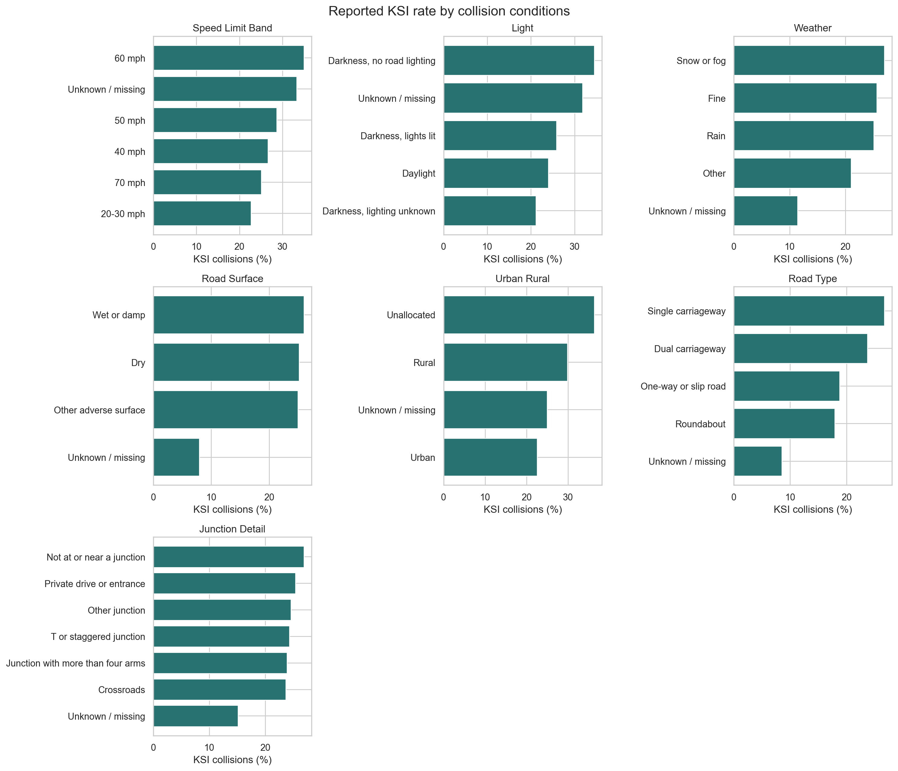
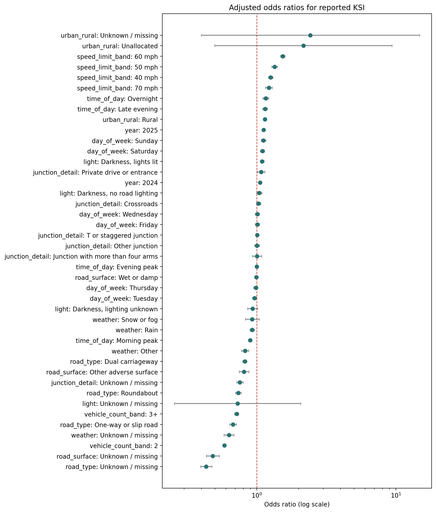
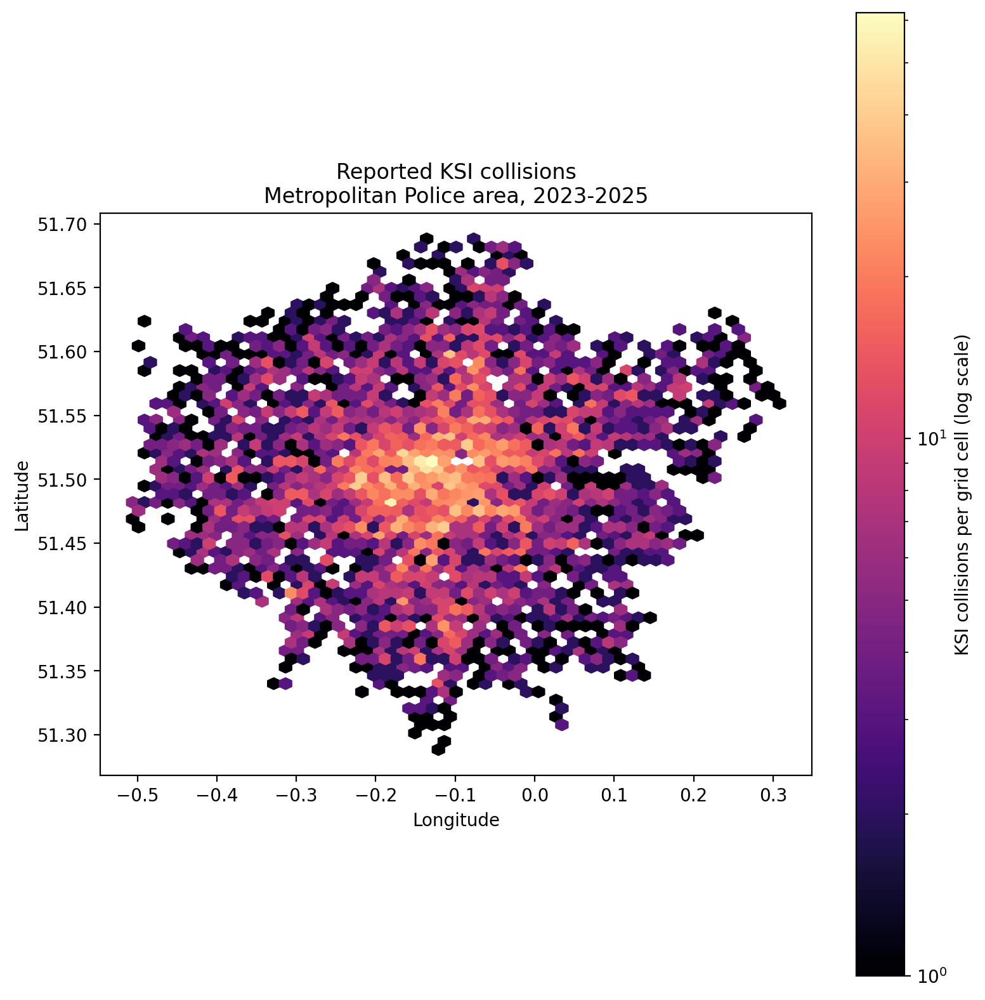

# Road Crash Severity Analysis

Which road, environmental and time conditions are associated with reported killed or seriously injured (KSI) collisions in Great Britain?

## Question

Crash severity matters because the consequences of a collision vary substantially, and understanding how reported severity differs across conditions can inform further safety research. This observational analysis estimates associations, not causes.

## Data and method

Collision-level STATS19 records for 2023-2025 are from the Department for Transport's [Road Safety Open Data](https://www.gov.uk/government/statistical-data-sets/road-safety-open-data). The selected files contain 306,710 collisions. Code labels follow the [DfT data guide](https://assets.publishing.service.gov.uk/media/6ab2a71d997a4b2950cced58/dft-road-casualty-statistics-road-safety-open-dataset-data-guide-2025.xlsx).

The primary outcome uses the recorded collision severity: Fatal or Serious = KSI; Slight = non-KSI. DfT adjusted severity fields are fractional weights, not replacement categories, so they are reported as a sensitivity rate rather than thresholded into binary labels. Categories are decoded and grouped for readability; unknown values are retained. Three records with unknown speed limits are excluded from model fitting only because that level is too sparse for a stable estimate.

Exploration reports group KSI rates, chi-square tests, and Cramer's V. The multivariable statsmodels logistic regression reports odds ratios and 95% confidence intervals. A stratified 80/20 split is used for a secondary ROC AUC check. Rare categories with expected counts below five are excluded from the relevant chi-square test only; they remain in the descriptive tables.

## Findings

- 76,673 of 306,710 collisions were reported as KSI (25.00%); the DfT-adjusted expected KSI rate was 25.94%.
- The crude KSI rate was 35.02% at 60 mph versus 22.72% in the combined 20-30 mph group; rural collisions were 29.88% versus 22.57% for urban collisions.
- Adjusting for the model predictors, 60 mph had 1.54 times the odds of reported KSI compared with 20-30 mph (95% CI 1.48-1.59).
- Test ROC AUC was 0.621, compared with 0.500 for a constant-prevalence baseline. All categorical tests had p < 0.001, while Cramer's V ranged from 0.035 to 0.095.







## Limitations

These are associations in police-reported personal-injury collisions, not causal effects. Slight collisions are under-reported, and severity recording changed as forces adopted injury-based systems; the DfT adjustment is therefore shown separately. Traffic exposure is unavailable, so counts and rates are not per journey or distance travelled. The spatial view uses the Metropolitan Police area, which is not identical to the Greater London administrative boundary.

## Reproduce

From the project root on macOS:

```sh
brew install python@3.12
python3.12 -m venv .venv
source .venv/bin/activate
python -m pip install -r requirements.txt

for year in 2023 2024 2025; do
	python src/download_data.py \
		--url "https://data.dft.gov.uk/road-accidents-safety-data/dft-road-casualty-statistics-collision-${year}.csv" \
		--filename "collision-${year}.csv"
done
```

Run the notebooks in order: `01_data_cleaning.ipynb`, `02_exploratory_analysis.ipynb`, `03_statistical_modelling.ipynb`, `04_spatial_view.ipynb`. Raw and processed data are ignored by Git.

**Tools:** Python, pandas, SciPy, statsmodels, scikit-learn, matplotlib, seaborn, Folium, and Jupyter.


